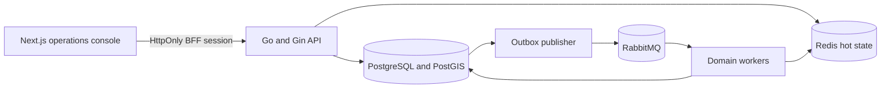

# Fleet Tracking

Portfolio-grade real-time fleet operations platform built as a Go modular monolith with independently runnable workers. The project is implemented milestone by milestone; this repository currently targets **Milestone 1: Foundation** and does not present later tracking features as complete.

## What Milestone 1 delivers

- Go 1.26 API and process boundaries for API, worker, outbox publisher, and simulator
- Gin HTTP policy, structured Zerolog output, correlation IDs, Prometheus metrics, and readiness/liveness separation
- PostgreSQL 17 with PostGIS, tenant-first schema, reversible migrations, and rerunnable demo data
- Redis and durable RabbitMQ topology with retry and dead-letter foundations
- Password verification with Argon2id, short-lived JWT access tokens, rotating hashed refresh tokens, logout, permissions, and tenant context
- OpenAPI 3.1 contract and consistent response/error envelopes
- Next.js operations console with a server-side BFF and `HttpOnly` session cookies
- Docker Compose, non-root application images, private data networks, CI, dependency updates, security scanning, and recovery docs

Telemetry ingestion, fleet CRUD, live WebSocket tracking, geofence processing, trip processing, alert delivery, and notification workers remain roadmap items. UI placeholders name their target milestone rather than simulate nonexistent behavior.

## Architecture



The architectural choice is deliberate: one codebase keeps transactions and solo development manageable, while separate stateless processes preserve independent scaling paths. See [architecture](docs/architecture.md) and the [ADRs](docs/adr/).

## Repository map

```text
cmd/                    process entry points
internal/identity/      authentication, sessions, RBAC, tenant context
internal/platform/      config, persistence, messaging, HTTP, observability
db/migrations/          immutable schema versions with up/down paths
db/queries/             explicit SQL and sqlc contracts
db/seeds/               rerunnable local/demo fixtures
api/openapi/            OpenAPI 3.1 contract
web/                    Next.js operations console and BFF
deployments/            containers, broker, metrics, tracing, proxy config
docs/                   architecture, ADRs, milestones, runbooks
tests/integration/      dependency-backed integration suites
```

## Quick start

Prerequisites: Docker with Compose v2, at least 4 GB free memory, and ports `3000`, `3001`, `5432`, `5672`, `6379`, `8080`, `9090`, and `15672` available on loopback.

```bash
cp .env.example .env
make bootstrap
```

Open:

| Surface | Address |
|---|---|
| Operations console | `http://localhost:3000` |
| API | `http://localhost:8080` |
| Liveness | `http://localhost:8080/health/live` |
| Readiness | `http://localhost:8080/health/ready` |
| Grafana | `http://localhost:3001` |
| Prometheus | `http://localhost:9090` |
| RabbitMQ management | `http://localhost:15672` |

Development login created by the seed:

```text
email:    admin@fleet.local
password: Admin123!
tenant:   nusantara-logistics
```

These credentials are public fixtures. Never use them in production.

## Useful commands

```bash
make help       # command inventory
make infra      # data and observability dependencies
make migrate    # apply schema versions
make seed       # load rerunnable demo data
make up         # guarded application build and start
make logs       # follow application logs
make verify     # race tests, vet, builds, lint, typecheck
make down       # stop without deleting volumes
```

On the RAMUNI production host, build commands automatically route through `ramuni-resource-guard` and `ramuni-safe-build`. On other hosts the scripts use the native command.

## API shape

Implemented Milestone 1 routes:

| Method | Route | Purpose |
|---|---|---|
| `POST` | `/api/v1/auth/login` | Verify user credentials and issue a token pair |
| `POST` | `/api/v1/auth/refresh` | Rotate a refresh token |
| `POST` | `/api/v1/auth/logout` | Revoke the presented session or family |
| `GET` | `/api/v1/me` | Return the authenticated profile and permissions |
| `GET` | `/health/live` | Process liveness without dependency checks |
| `GET` | `/health/ready` | PostgreSQL, Redis, and RabbitMQ readiness |
| `GET` | `/metrics` | Private Prometheus scrape endpoint |

The full contract is in [`api/openapi/openapi.yaml`](api/openapi/openapi.yaml).

Success envelope:

```json
{
  "data": {},
  "meta": {"requestId": "01J..."}
}
```

Error envelope:

```json
{
  "error": {
    "code": "validation_failed",
    "message": "One or more fields are invalid.",
    "requestId": "01J...",
    "details": [
      {
        "field": "email",
        "code": "invalid_format",
        "message": "Must be a valid email address."
      }
    ]
  }
}
```

## Security model

- Every business query takes tenant identity explicitly; a resource ID alone is insufficient authorization.
- Passwords use Argon2id. Refresh tokens are random opaque values stored only as hashes.
- Access JWTs expire in 15 minutes by default. Refresh rotation detects replay and revokes the token family.
- The browser BFF holds tokens in `HttpOnly`, `SameSite=Lax` cookies rather than local storage.
- Public CORS origins and trusted proxies are allowlists.
- Application containers are non-root, read-only, and deny privilege escalation.
- Data, broker, monitoring, and metrics surfaces are not public deployment endpoints.
- Secrets come from environment injection or a secret manager and are redacted from logs.

Read [SECURITY.md](SECURITY.md) before deploying or reporting a vulnerability.

## Observability

JSON logs carry service, environment, request/correlation ID, safe actor context, route, status, duration, and stable error codes. Prometheus starts with HTTP and runtime metrics. OpenTelemetry accepts OTLP traffic and keeps trace plumbing ready for the ingest-to-worker path. High-cardinality tenant, user, and vehicle identifiers are excluded from metric labels.

## Verification

The release gate is:

```bash
make verify
docker compose --profile tools run --rm migrate
docker compose --profile tools run --rm seed
```

Capacity targets from the BRD are hypotheses until Milestone 6 k6 and WebSocket load reports exist. No production throughput claim is made from unit tests or local smoke tests.

## Delivery roadmap

| Milestone | Focus | State |
|---|---|---|
| 1 | Foundation, identity skeleton, local stack, API contract, console shell | Current |
| 2 | Fleet, device credentials, telemetry, outbox, simulator | Planned |
| 3 | Authenticated WebSocket tracking and live map | Planned |
| 4 | Geofence and trip processing | Planned |
| 5 | Offline detection, alerts, notifications, retry and DLQ | Planned |
| 6 | Full observability, security hardening, E2E and load evidence | Planned |
| 7 | Portfolio polish and public demo | Planned |

The next implementation gate is documented in [Milestone 1](docs/milestones/01-foundation.md). Milestone 2 must not begin until the foundation acceptance evidence is reviewed.

## Production deployment

`fleet.meetsin.id` should terminate TLS at the host edge and expose only the web and API routes. Database, Redis, RabbitMQ management, Grafana, Prometheus, and `/metrics` remain private. Use `.env.production.example` only as a key inventory; replace every placeholder from the deployment secret store. The bundled PostgreSQL connection uses `sslmode=disable` because it stays on Compose's private `data` network; external or managed PostgreSQL must use `sslmode=verify-full` with a trusted CA and verified hostname. The host edge must replace untrusted `X-Forwarded-For` input before forwarding so the loopback-only nginx proxy can recover the client address safely.

Before deployment:

1. Back up the current host and verify available memory.
2. Run the complete release gate.
3. Apply migrations as a distinct, observable step.
4. Start containers with bounded memory and verify readiness from the private network.
5. Switch proxy traffic only after smoke checks pass.
6. Retain the previous image and documented rollback command.

The full host procedure is in [VM deployment](docs/runbooks/deploy-vm.md), and the data recovery procedure is in [backup and restore](docs/runbooks/backup-restore.md).

## License

MIT, see [LICENSE](LICENSE).
