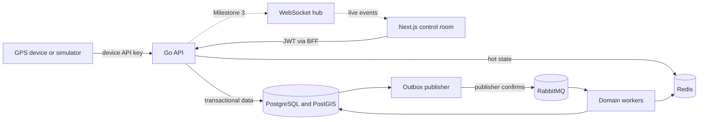
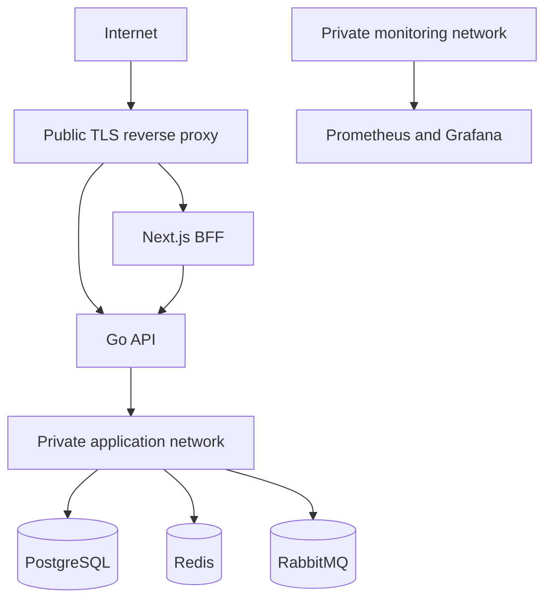

# Architecture

## Context

Fleet Tracking is a modular monolith with separately deployable process roles. PostgreSQL is the source of truth, Redis holds rebuildable hot state, and RabbitMQ carries at-least-once domain events.



## Process model

| Binary | Milestone 1 responsibility | Scaling direction |
|---|---|---|
| `api` | Auth, tenant context, health, metrics, HTTP policy | Horizontal and stateless |
| `worker` | Dependency-aware lifecycle shell for domain consumers | Per queue or workload |
| `outbox-publisher` | Lifecycle shell for reliable event publication | Competing publishers with row locking |
| `simulator` | Configuration shell; route generation begins in Milestone 2 | Local/demo only |
| `web` | Secure BFF session and operations console shell | Horizontal with shared API state |

The worker and publisher binaries are intentionally thin in Milestone 1. Domain consumers and outbox leasing belong to later accepted stories and are not represented as complete.

## Module boundaries

```text
identity     tenant, user, role, permission, refresh session
fleet        vehicle, device, assignment
tracking     telemetry, latest position, live stream
geofence     spatial definitions and transitions
trip         lifecycle and distance aggregation
alert        alert lifecycle
notification preferences and channel delivery
audit        immutable activity trail
platform     config, transport, persistence, messaging, observability
```

Modules own their domain decisions. Transport handlers translate input and output; services authorize and coordinate; repositories perform tenant-scoped persistence. Platform packages contain infrastructure, not business policy.

## Trust boundaries



Device credentials and user credentials never share a mechanism. Browser refresh tokens are held only in `HttpOnly`, `SameSite=Lax` cookies by the BFF. API authorization is enforced again in service methods; middleware alone is not the security boundary.

## Data and delivery guarantees

- PostgreSQL commits business data and outbox data atomically.
- RabbitMQ delivery is at least once; consumer effects require an idempotency record.
- Redis is never the only copy of historical or latest durable state.
- Latest telemetry updates use recorded time as a monotonic guard.
- Refresh token rotation locks the presented token row before replacement.

## Deployment boundaries

Local Compose binds data services to `127.0.0.1`. The production edge should expose only ports 80/443, terminate TLS, and proxy to the internal reverse proxy or directly to `web` and `api`. Monitoring and broker management ports remain private.
